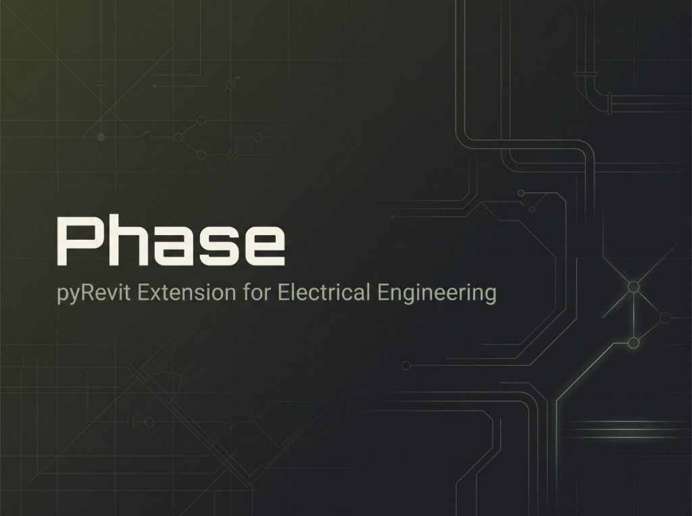

<p align="center">
  
</p>

# Phase

Extensão para o **Autodesk Revit** desenvolvida para o ecossistema **pyRevit**, com foco em automação, cálculo e produtividade para projetos de instalações elétricas prediais e industriais.

## 🚀 Funcionalidades

- **Locação de Eletroduto (`LocEletroduto`):**
  - Classifica automaticamente os eletrodutos (`Sobreposto`, `Enterrado`, `Embutido na Laje` ou `Parede`).
  - Interface visual dedicada com ajuste da altura de laje, prévia em tempo real, quantitativo em metros e filtros por diâmetro e situação.
  - Gravação transacional segura no Revit com suporte completo a Undo (`Ctrl+Z`).
- **Especificação de Bomba (`EspecBomba`):**
  - Lista as bombas do projeto e permite editar especificações técnicas diretamente pela interface.
  - Gera e padroniza automaticamente o parâmetro *"Descrição do Material"* para a bomba e para o Quadro de Comando de Bombas (QCB).
  - Gravação individual ou combinada com validação prévia de dados.

## 📦 Como Instalar no Autodesk Revit

### Pré-requisitos
- **Autodesk Revit** (versões compatíveis com o pyRevit).
- **[pyRevit](https://github.com/eirannejad/pyRevit)** instalado e configurado.

### Passo a Passo

1. Abra o terminal (Prompt de Comando ou PowerShell) e navegue até a pasta de extensões do pyRevit:
   ```cmd
   cd %APPDATA%\pyRevit\Extensions
   ```
2. Clone este repositório com o nome terminando em `.extension`:
   ```bash
   git clone https://github.com/nynsu/Phase.git Phase.extension
   ```
3. Abra ou reinicie o **Autodesk Revit**.
4. Uma nova aba chamada **Phase** estará disponível na faixa de opções (Ribbon) do Revit.

## 🛠️ Tecnologias Utilizadas

- **Python (IronPython / pyRevit CLI)**
- **Revit API** (Autodesk Revit SDK)
- **XAML / WPF** para construção das interfaces gráficas (UI)

## 📄 Licença

Este projeto está licenciado sob a **GNU General Public License v3.0 (GPLv3)** - consulte o arquivo [LICENSE](LICENSE) para mais detalhes. Qualquer projeto derivado deve manter a atribuição de autoria e permanecer sob código aberto.
